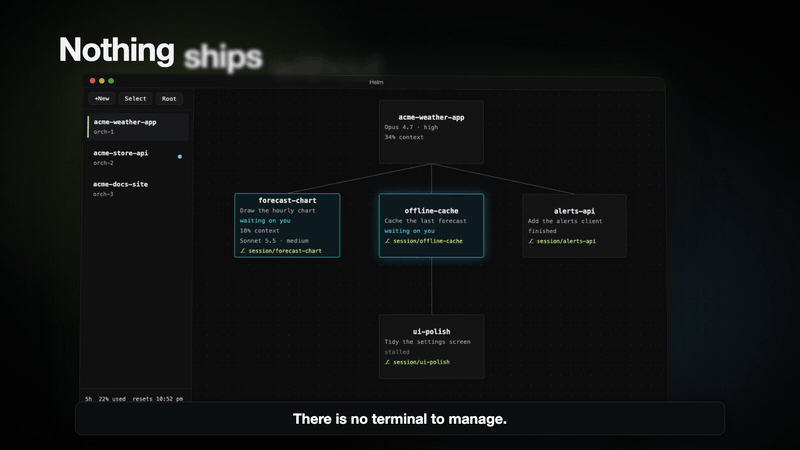

# Helm

**A native macOS home for running many Claude Code sessions at once.**

[](docs/media/helm-demo.mp4)

*Click the preview to watch the full video (`docs/media/helm-demo.mp4`). Music
and voice credits are in [`docs/media/CREDITS.md`](docs/media/CREDITS.md).*

> Helm was called Canopy-Foreman until November 2026.

Helm is a Mac app for developers who run Claude Code on many
projects and many tasks at the same time. Each project gets an orchestrator
session. Each task gets its own worker session in its own git worktree. The
app shows all of them in one window and lets you talk to any of them. Every
decision that needs a human (a tool call, a question, a `git push`) reaches
you as a card. You approve, deny or answer it.

Claude sessions never run in a terminal window. The one exception is a plain
zsh shell for your own commands. Every session is still the real
`claude` CLI, so your hooks, plugins, skills, MCP servers and approval gates
keep working exactly as they do in a terminal.

> The app, its executable and its Swift package are all called Helm. The
> bundle id is `io.github.whoreallyknowsanything.helm`.

---

## Contents

- [Why it exists](#why-it-exists)
- [How it works](#how-it-works)
- [What you can do with it](#what-you-can-do-with-it)
- [The Cadence workflow area](#the-cadence-workflow-area)
- [Safety model](#safety-model)
- [Requirements](#requirements)
- [Download](#download)
- [Build and install](#build-and-install)
- [Running the tests](#running-the-tests)
- [Project layout](#project-layout)
- [Design system](#design-system)
- [How this project is built](#how-this-project-is-built)
- [Limits and non-goals](#limits-and-non-goals)

---

## Why it exists

Running several Claude Code sessions in parallel works, but it is hard to
follow. Sessions live in terminal tabs. A worker that waits for a permission
answer stops silently in a tab you are not looking at. You must also merge
each worker's branch, remove its worktree and remember which task it was
doing. All of these steps are manual, and they get worse with each session
you add.

Helm replaces that terminal flow with one window:

- **See everything.** Every open project, its orchestrator and its workers,
  with a live status for each.
- **Work in any session.** A native conversation view for every session, with
  no terminal for Claude sessions (a plain zsh shell for your own commands
  is the one exception).
- **Decide in one place.** Permission prompts, questions and git pushes from
  any worker arrive as cards in the app.
- **Run a real workflow.** A board and stage screens for
  [Cadence](https://github.com/crenshawdev/cadence) (context, plan, execute,
  verify, milestone, land), so the development process is part of the app.

## How it works

Helm is a front end. The engine is the
[multi-session orchestrator](orchestration/)
(a set of shell scripts and Claude Code prompts), and every session is the
`claude` CLI.

```
                    Helm (SwiftUI, macOS)
     project tree · conversations · cards · workflow board · editor
           │ reads                         │ writes answers / starts work
           ▼                               ▼
   tmux sessions & windows        orchestrator scripts
   .claude/session-state.db       (launch-claude.sh, dispatch-task.sh,
   .claude/sessions/<label>/       merge-review.sh, git-approval-gate.sh)
     inbox.jsonl / out.jsonl               │
           ▲                               ▼
           └──────────── claude -p (stream-json), one per session
                          orchestrator: project root
                          worker:       .claude/worktrees/<label>/
```

**One orchestrator per project.** Opening a project starts an orchestrator
session in a background tmux session. The orchestrator drafts task prompts,
picks up Notion tasks, starts workers and merges their work. You talk to it in
the app like any chat.

**One worker per task.** A worker runs in its own git worktree on a
`session/<label>` branch, in its own tmux window. Workers cannot step on each
other's files, and each one's work is reviewed and merged on its own.

**Headless sessions, native view.** Every session runs as
`claude -p --input-format stream-json --output-format stream-json`. The app
writes your messages into the session's `inbox.jsonl` and reads the
conversation from its `out.jsonl`. It draws messages, tool calls, diffs and
images natively. Permission prompts use Claude Code's `stdio` permission tool,
so a prompt becomes a card in the app, and your answer goes back into the
session.

**Shared state.** The orchestrator keeps a small SQLite store,
`.claude/session-state.db`, with every session's status, task title, model and
file paths. The app reads it (read-only) and watches the project folder for
changes. It does not poll on a timer.

**Same environment as your terminal.** Sessions the app starts carry the
environment of your login shell, so your hooks, plugins, skills and MCP servers
work the same as in a terminal. Optional tools such as lean-ctx or RTK work
the same way if you use them. Helm does not need them.

## What you can do with it

### Projects and sessions

- Open any git repository as a project, or create a new one (it can also create
  the GitHub repository and a Notion project row).
- Start a plain "root" session that is not tied to a project.
- See every project, orchestrator and worker in a tree, with a status dot:
  running, waiting for you, blocked, finished, merged or ended.
- Workers whose process has gone are shown as ended, with a way to clear them.
- Open projects come back after the app or the Mac restarts.

### Conversations

- A native chat view for every session: your messages, Claude's replies, tool
  calls, diffs, images and sub-agents.
- The message box takes focus when you switch project or node, so you can
  type at once.
- Send messages, drop in files, stop a running turn, and use the commands that
  normally need a terminal screen (`/model`, `/effort`, `/compact`, `/mcp`,
  `/login`, `/status`) natively.
- Cross-session messages between orchestrator and workers are shown in line.

### Cards: everything that needs you

- **Permission cards.** A tool call that needs approval shows Allow and Deny.
  Allow works at once.
- **Hold cards.** Every `git push` and `gh pr create` that a
  worker runs is held by the git approval gate until you press Approve or
  Deny. Commits are not held. They run with no approval. The card shows on the worker's tree node and at the top of every
  session view in that project.
- **Question cards.** A worker's `AskUserQuestion` shows its options as a card.
  Decline needs a second click, and every deny the app writes is logged with
  its source.
- **Alerts and badges.** A banner and a dock badge tell you when something is
  waiting, in any project.

### Tasks, dispatch and merge

- The orchestrator's open Notion tasks show in the app. Pick one, and the
  orchestrator drafts the task, starts a worker and hands it the task.
- A worker commits after each finished step. When its task is done, it sends
  a completion report to the orchestrator.
- When a worker finishes, the orchestrator offers a merge review. The merge
  checks for conflicts, merges the branch and removes the worktree.
- The app shows each worker's pull request, its checks and the changed files.

### Code editor

- Open files from a link in any conversation or workflow screen.
- View and edit code with syntax colouring, a line gutter and go-to-line.
- A banner warns you when the file changed on disk, and a worker's files open
  read-only.

### Terminal

- A plain zsh shell inside the app, for your own commands (git, builds).
- Open it in a project's folder with the **Open terminal** button on that
  project, or in your home folder with the terminal button at the bottom of
  the sidebar, beside the usage lines.
- The shell starts as a login shell (`zsh -l`), with colours, resize and
  scrollback.
- Each terminal (Home and each project) stays alive when you switch away. Its
  history is still there when you return. Helm keeps one shell for each folder.
- The **Clear** button stops the shell and starts a fresh one in the same
  folder. Closing the project or quitting the app also stops the shell. A
  shell that exited is replaced the next time you show the terminal.
- Only your shell runs here. Claude sessions always stay in the native
  conversation view.

## The Cadence workflow area

[Cadence](https://github.com/crenshawdev/cadence) is a Claude Code plugin for
planned work: it gathers context, writes a plan, executes it with sub-agents,
and verifies the result with you. Cadence stays the engine and writes every
`.planning/` file. Helm gives each stage a native screen and starts
the right worker for it.

The workflow area is one shell with a phase picker and a tab per stage:

| Tab | What it shows |
|---|---|
| **Board** | One row per phase of the current milestone, with the milestone's "N of M" progress, each phase's stage, its worker's status (running, waiting to merge, ended, question waiting, plan ready) and a read-only mark for any held git operation. One primary **Next** button starts the next stage with the right model and effort. Phase checks (coverage, minimalism review, decision review) are 1-click buttons on their row; project-wide checks (suggest, health, audit) are in the **Suggested** menu. Approve and Deny stay in the project's hold bar. |
| **Context** | The gray areas Cadence asks about, as cards you answer, and the decisions and acceptance criteria it records. |
| **Plan** | The phase plans, the plan check and the plan review. **Approve** moves on to execute. |
| **Execute** | Live progress of an execute run: waves, plans, each plan's commits and any checkpoint that needs you. |
| **Verify** | The UAT checklist. Mark each item **Pass** or **Fail**; a failed item can be sent back for a fix. |
| **Run record** | Cadence's run record: what each role did, its cost, and tuning suggestions you can apply to the Cadence config. |
| **Milestone** | The milestone audit, the close, and the land step (push, pull request, merge, tag). |

Each stage runs as its own worker (for example `cad-execute-p2`). Stage gates
stop a stage from starting before the one it needs is done, and a health strip
shows problems such as a missing config or a cursor that disagrees with the
files.

The app follows Cadence 4.3's layout, where run records live under
`.planning/records/` and each phase's reviews and reports live under
`.planning/phases/<N>/records/`.

## Safety model

The app is built so that no session can approve its own risky actions:

- **Git operations need a person.** The orchestrator's git approval gate holds
  every `git push` and `gh pr create` from a worker until you press Approve or
  Deny in the app. Commits are not held. A hold that nobody answers is denied
  after 600 seconds. It never falls back to "allow".
- **No back door.** The app has no HTTP endpoint, socket, URL scheme or
  AppleScript command that can approve a hold. A worker could call such a thing
  and approve itself, so it does not exist.
- **Answers go only where they belong.** The app writes an answer only into the
  inbox of the session that asked.
- **tmux is handled per project.** Closing a project stops only that project's
  tmux sessions. The app never stops the whole tmux server.
- **Read-only where it matters.** The app reads the state database read-only
  and never writes Cadence's `.planning/` files.

## Requirements

- macOS 27 or later (Apple silicon).
- Swift 6.4 toolchain (Xcode or the command-line tools). The package uses the
  Swift 5 language mode.
- A signing identity is optional. The build uses an **Apple Development**
  identity from your keychain when it finds one, and signs ad hoc when it does
  not. Notification banners are not checked with an ad-hoc signature
  (unverified).
- [`tmux`](https://github.com/tmux/tmux), `git`, `sqlite3` (part of macOS) and
  `node`. The install step needs `node`.
- The [`claude` CLI](https://code.claude.com/), signed in.
- The [multi-session orchestrator](orchestration/) is part of this repo. The
  app copies it to `~/Library/Application Support/Helm/orchestration`.
- Optional: the [Cadence](https://github.com/crenshawdev/cadence) plugin for
  the workflow area, `jq` and an authenticated `gh` CLI for the New Project
  flow and pull request state.
- Optional, and Helm works without each of them:
  - **lean-ctx.** The git approval gate covers both Claude Code's native `Bash`
    tool and lean-ctx's shell tool. Without lean-ctx, workers run git through
    `Bash` and the gate holds those pushes in the same way. The
    install step adds the `Bash` gate to `~/.claude/settings.json` unless a
    gate for `Bash` already exists there or in `~/.claude/settings.local.json`.
  - **[Terminus](https://github.com/crenshawdev/terminus).** A local memory
    tool that archives Claude Code transcripts and recalls them in later
    sessions. It makes no model calls. It works on macOS and Linux. Install it
    with
    `curl -fsSL https://raw.githubusercontent.com/crenshawdev/terminus/main/install.sh | sh`.
    It hooks into Claude Code itself, so every orchestrator and worker session
    Helm starts gets recall with no Helm setup.
  - **headroom.** Launch starts its proxy when `headroom` is on `PATH`.
  - **Notion.** The orchestrator needs the `notionApi` MCP server
    (`@notionhq/notion-mcp-server`) and your Notion data source IDs. Give the
    IDs to `orchestration/install.sh` with `--notion-projects-ds` and
    `--notion-tasks-ds`, or put them in `notion.env` in the Helm support folder.
    Without them, Notion stays off.

## Download

Helm needs Apple silicon and macOS 27 or later, as Requirements says.

1. Download `Helm-<version>.dmg` and `Helm-<version>.dmg.sha256` from the
   [Releases page](https://github.com/WhoReallyKnowsAnything/Helm/releases).
2. Check the download. Run this in the folder that holds both files. It must
   print `OK`.

   ```bash
   shasum -a 256 -c Helm-<version>.dmg.sha256
   ```

3. Open the disk image. Drag Helm into Applications.

   Warning: the app is ad-hoc signed and not notarized. macOS blocks the first
   open. Do step 4 before step 5.

4. Try to open `/Applications/Helm.app`. Then open System Settings > Privacy &
   Security and click Open Anyway. Or run this command instead:

   ```bash
   xattr -dr com.apple.quarantine /Applications/Helm.app
   ```

5. Open Helm once. It copies the orchestrator to
   `~/Library/Application Support/Helm/orchestration`.
6. Run `install.sh` from that folder. It needs `node`.

   ```bash
   "$HOME/Library/Application Support/Helm/orchestration/install.sh"
   ```

## Build and install

```bash
git clone https://github.com/WhoReallyKnowsAnything/Helm.git
cd Helm
./scripts/bundle-app.sh
```

`bundle-app.sh` builds a release binary with `swift build -c release`, wraps it
in `build/Helm.app`, signs it (Apple Development identity when present, else ad
hoc) and installs it to `/Applications/Helm.app`.

Then finish the setup:

1. Open `/Applications/Helm.app` once. It copies the orchestrator to
   `~/Library/Application Support/Helm/orchestration`.
2. Run `install.sh` from that folder. It registers the hooks in
   `~/.claude/settings.json` and installs the LaunchAgent. It needs `node`.

   ```bash
   "$HOME/Library/Application Support/Helm/orchestration/install.sh"
   ```

For a quick debug build without the bundle:

```bash
swift build
swift run Helm
```

After a rebuild, quit the app and open it again to load the new build. In the
quit dialog, leave a project unchecked to keep its sessions running in tmux.

## Running the tests

```bash
swift test
```

The suite has more than 1,600 tests. It includes render tests that draw each
screen in light and dark appearance to the git-ignored `screenshots/` folder,
so you can look at every state without running the app. Two scripts check the
design rules:

```bash
scripts/design-gates.sh   # design-kit token and component rules
scripts/grid-lint.sh      # spacing values stay on the layout grid
```

`scripts/make-fixture-project.sh <dir>` writes a fixture
`.claude/session-state.db` for tests and manual checks.

## Project layout

```
Sources/Helm/                 the app (SwiftUI + AppKit, about 180 files)
  DesignKit/                  the app's own design system: tokens and parts
Tests/HelmTests/              unit, store and render tests
Resources/                    Info.plist and the app icon
scripts/                      build, design checks and fixtures
design/KIT.md                 design-kit reference: which token and part to use
docs/media/                   the product video, its preview and credits
video/                        the video's Remotion source (scripts/make-demo-video.sh builds it)
```

The code follows one pattern throughout: a small **store** reads a source
(tmux, the state database, a session's `out.jsonl`, `.planning/` files),
publishes plain values, and a **view** draws them. Watchers react to file
changes, so screens update without polling.

## Design system

The app has its own look rather than stock controls: a dark theme, flat
panels, 1-pixel borders and small corners, with status shown as a coloured dot
and text. Cyan marks only what waits on you; blue marks work that is running.
The design kit in `Sources/Helm/DesignKit/` holds the colour, type
and spacing tokens and every shared part (buttons, rows, tabs, cards, the
phase picker). `design/KIT.md` says which token or part to use where, and the
design-gate script keeps the code to it. Button and title text follows macOS
title case.

## How this project is built

Helm is built with Claude Code, through the same orchestrator and
Cadence workflow it shows. Each milestone was planned and verified with
Cadence:

| Milestone | What it added |
|---|---|
| v1 | Project tree, terminal view, hold cards, alerts, dispatch, merge and teardown |
| v1.1 | The style redesign and restoring open projects after a restart |
| v2 | Headless sessions and the native conversation view; the terminal was removed |
| v3 | The Cadence workflow board, health strip, Context, Plan review and UAT screens |
| v4 | Execute progress, run record, milestone and land screens, the code editor, and the one-shell workflow redesign |
| v5 | Support for Cadence 4.3's record layout, and a set of fixes and polish |
| v8 | A plain zsh terminal screen (project folder and home folder) and the redesigned workflow board |

The planning history lives in the private development repo. This public repo
does not include it.

## Limits and non-goals

- **Not notarized.** Anyone may build Helm or download a release. The app is
  not notarized. `scripts/bundle-app.sh` signs
  with an Apple Development identity when your keychain has one, and signs ad
  hoc when it does not. An app built on your own Mac has no download
  quarantine flag, so Gatekeeper is not expected to stop it (unverified). If
  macOS blocks a copy that came by download, open it with right-click, then
  Open. Or allow it in System Settings, Privacy & Security (unverified).
- **macOS only.**
- **Not the Agent SDK.** Sessions stay the `claude` CLI on purpose, so every
  hook, plugin and approval gate keeps working.
- **No workflow engine of its own.** Cadence does the planning and writes the
  files; the app shows the state and sends your answers.
- **No full diff viewer.** The app shows pull request state, checks and changed
  files, and opens GitHub for the full diff.

## License

MIT. See [`LICENSE`](LICENSE).
